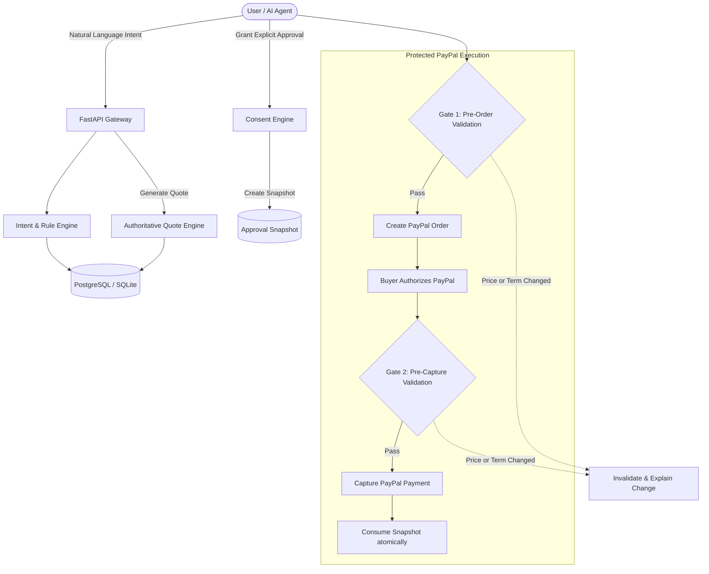

# IntentLock 🔒

> **Zero-Surprise AI Commerce Engine** with deterministic consent validation, real-time merchant policy enforcement, and PayPal Sandbox checkout integration.

---

## 💡 The Problem

In conversational and autonomous AI commerce, autonomous agents often browse catalogs, generate quotes, and negotiate transactions on behalf of users. However:
- **Bait-and-Switch**: Merchant catalog items, prices, shipping fees, or return policies can change between quote creation and payment capture.
- **Agent Hallucinations**: Generative AI models can misquote prices, misinterpret user budgets, or accept unauthorized merchant substitutions.
- **Replay & Concurrency Exploits**: Buyers or malicious scripts can replay old, under-priced quotes or initiate duplicate captures concurrently.

## 🛡️ The Solution: IntentLock

IntentLock inserts an immutable, cryptographic-grade **Consent & Policy Validation Barrier** between AI shopping interactions and payment capture:
1. **Deterministic Intent Extraction**: User requirements (budget, specifications, return policies) are structured and bounded by strict schema constraints.
2. **Server-Authoritative Quoting**: Client-submitted prices are discarded; quotes are generated strictly against immutable `ProductVersion` records.
3. **Dual-Gate Pre-Flight Consent**:
   - **Gate 1 (`validate_before_create`)**: Validates active consent and immutable quote consistency before the payment order is created.
   - **Gate 2 (`validate_before_capture`)**: Validates active consent, catalog integrity, price locks, and return policies right before capture.
4. **Instant Invalidation on Material Change**: If a merchant spikes prices or changes terms, approvals are instantly invalidated and plain-English grounded explanations are generated for the buyer.
5. **Replay & Double-Spend Immunity**: Approvals transition atomically from `ACTIVE` to `CONSUMED`. Replaying or re-capturing is blocked at the database engine level.

---

## 🏛️ System Architecture

